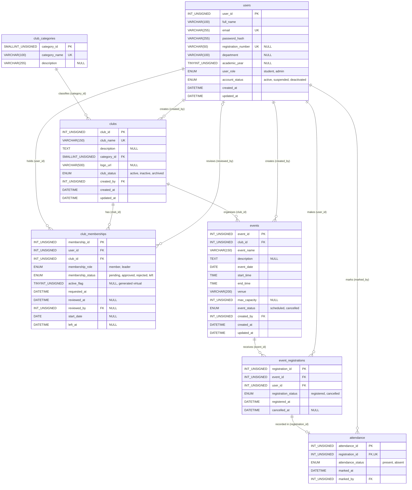
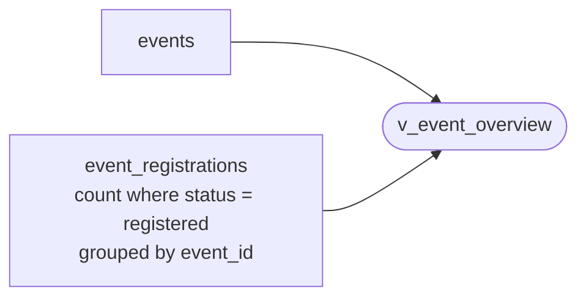

# Club Management System – Entity Relationship Diagram

## 1. Database Overview

The `club_management_system` database (MySQL 8.0.16+, InnoDB, `utf8mb4`) supports a college club platform where:

- students and administrators have accounts (`users`);
- clubs belong to a category (`club_categories`, `clubs`);
- students request membership, and approved members can hold a leader role (`club_memberships`);
- clubs organise events (`events`);
- students register for events and can cancel (`event_registrations`);
- attendance is recorded for registrations (`attendance`).

It consists of **seven tables** and **one view** (`v_event_overview`). The view is not a table and is not drawn in the ER diagram; it is described separately in Section 6.

---

## 2. ER Diagram

**How to read the diagram**

- `PK` = primary key, `FK` = foreign key, `UK` = single-column unique constraint.
- A column is `NOT NULL` unless its comment says `NULL`.
- Column types are written with `_` in place of a space (for example `INT_UNSIGNED` is `INT UNSIGNED`), because Mermaid type names cannot contain spaces. `ENUM` columns list their allowed values in the comment.
- Relationship labels show the foreign-key column that creates the relationship. `||` on the parent side means every child row has exactly one parent. `|o` on the parent side means the parent is optional (`reviewed_by` is nullable). `o{` means zero or more child rows.
- Mermaid cannot show composite unique keys, CHECK constraints, defaults, or foreign-key delete/update actions; these are listed in Sections 4 to 6.

---

## 3. Entity Descriptions

### `users`
Accounts for students and administrators. Stores login data (`email`, `password_hash`) and optional profile details.

| Column | Type | Key | Null | Default / notes |
|---|---|---|---|---|
| user_id | INT UNSIGNED, AUTO_INCREMENT | PK | NOT NULL | |
| full_name | VARCHAR(100) | | NOT NULL | |
| email | VARCHAR(255) | UNIQUE | NOT NULL | Comparison is case-insensitive (collation) |
| password_hash | VARCHAR(255) | | NOT NULL | Hash only |
| registration_number | VARCHAR(50) | UNIQUE | NULL | Optional student ID |
| department | VARCHAR(100) | | NULL | Optional |
| academic_year | TINYINT UNSIGNED | | NULL | Optional |
| user_role | ENUM('student','admin') | | NOT NULL | `'student'` |
| account_status | ENUM('active','suspended','deactivated') | | NOT NULL | `'active'` |
| created_at | DATETIME | | NOT NULL | `CURRENT_TIMESTAMP` |
| updated_at | DATETIME | | NOT NULL | `CURRENT_TIMESTAMP`, `ON UPDATE CURRENT_TIMESTAMP` |

### `club_categories`
Lookup table of club categories.

| Column | Type | Key | Null | Default / notes |
|---|---|---|---|---|
| category_id | SMALLINT UNSIGNED, AUTO_INCREMENT | PK | NOT NULL | |
| category_name | VARCHAR(100) | UNIQUE | NOT NULL | |
| description | VARCHAR(255) | | NULL | |

### `clubs`
The clubs. Each club has exactly one category and one creating user.

| Column | Type | Key | Null | Default / notes |
|---|---|---|---|---|
| club_id | INT UNSIGNED, AUTO_INCREMENT | PK | NOT NULL | |
| club_name | VARCHAR(150) | UNIQUE | NOT NULL | |
| description | TEXT | | NULL | |
| category_id | SMALLINT UNSIGNED | FK → `club_categories.category_id` | NOT NULL | |
| logo_url | VARCHAR(500) | | NULL | |
| club_status | ENUM('active','inactive','archived') | | NOT NULL | `'active'` |
| created_by | INT UNSIGNED | FK → `users.user_id` | NOT NULL | |
| created_at | DATETIME | | NOT NULL | `CURRENT_TIMESTAMP` |
| updated_at | DATETIME | | NOT NULL | `CURRENT_TIMESTAMP`, `ON UPDATE CURRENT_TIMESTAMP` |

### `club_memberships`
Links users to clubs. Holds the membership request and review workflow, the membership role (`member` or `leader`, which is how club leadership is represented), and membership history.

| Column | Type | Key | Null | Default / notes |
|---|---|---|---|---|
| membership_id | INT UNSIGNED, AUTO_INCREMENT | PK | NOT NULL | |
| user_id | INT UNSIGNED | FK → `users.user_id` | NOT NULL | The member |
| club_id | INT UNSIGNED | FK → `clubs.club_id` | NOT NULL | |
| membership_role | ENUM('member','leader') | | NOT NULL | `'member'` |
| membership_status | ENUM('pending','approved','rejected','left') | | NOT NULL | `'pending'` |
| active_flag | TINYINT UNSIGNED | Generated (VIRTUAL) | NULL | `IF(membership_status IN ('pending','approved'), 1, NULL)` |
| requested_at | DATETIME | | NOT NULL | `CURRENT_TIMESTAMP` |
| reviewed_at | DATETIME | | NULL | Approval or rejection time |
| reviewed_by | INT UNSIGNED | FK → `users.user_id` | NULL | Reviewer |
| start_date | DATE | | NULL | |
| left_at | DATETIME | | NULL | |

### `events`
Events organised by a club.

| Column | Type | Key | Null | Default / notes |
|---|---|---|---|---|
| event_id | INT UNSIGNED, AUTO_INCREMENT | PK | NOT NULL | |
| club_id | INT UNSIGNED | FK → `clubs.club_id` | NOT NULL | Organising club |
| event_name | VARCHAR(150) | | NOT NULL | |
| description | TEXT | | NULL | |
| event_date | DATE | | NOT NULL | |
| start_time | TIME | | NOT NULL | |
| end_time | TIME | | NOT NULL | Must be later than `start_time` |
| venue | VARCHAR(200) | | NOT NULL | |
| max_capacity | INT UNSIGNED | | NULL | NULL = no participant limit |
| event_status | ENUM('scheduled','cancelled') | | NOT NULL | `'scheduled'` |
| created_by | INT UNSIGNED | FK → `users.user_id` | NOT NULL | |
| created_at | DATETIME | | NOT NULL | `CURRENT_TIMESTAMP` |
| updated_at | DATETIME | | NOT NULL | `CURRENT_TIMESTAMP`, `ON UPDATE CURRENT_TIMESTAMP` |

### `event_registrations`
Links users to events. One row per user per event.

| Column | Type | Key | Null | Default / notes |
|---|---|---|---|---|
| registration_id | INT UNSIGNED, AUTO_INCREMENT | PK | NOT NULL | |
| event_id | INT UNSIGNED | FK → `events.event_id` | NOT NULL | Part of unique key `(event_id, user_id)` |
| user_id | INT UNSIGNED | FK → `users.user_id` | NOT NULL | Part of unique key `(event_id, user_id)` |
| registration_status | ENUM('registered','cancelled') | | NOT NULL | `'registered'` |
| registered_at | DATETIME | | NOT NULL | `CURRENT_TIMESTAMP` |
| cancelled_at | DATETIME | | NULL | |

### `attendance`
Attendance outcome for a registration. At most one row per registration.

| Column | Type | Key | Null | Default / notes |
|---|---|---|---|---|
| attendance_id | INT UNSIGNED, AUTO_INCREMENT | PK | NOT NULL | |
| registration_id | INT UNSIGNED | FK → `event_registrations.registration_id`, UNIQUE | NOT NULL | |
| attendance_status | ENUM('present','absent') | | NOT NULL | |
| marked_at | DATETIME | | NOT NULL | `CURRENT_TIMESTAMP` (no automatic update) |
| marked_by | INT UNSIGNED | FK → `users.user_id` | NOT NULL | |

---

## 4. Relationship Explanations

Every relationship below comes from a foreign key in the SQL script.

| # | Parent (one side) | Child (many side) | FK column | Cardinality | Notes |
|---|---|---|---|---|---|
| 1 | `club_categories` | `clubs` | `clubs.category_id` | One-to-many | A club has exactly one category; a category can have many clubs |
| 2 | `users` | `clubs` | `clubs.created_by` | One-to-many | The user who created the club |
| 3 | `users` | `club_memberships` | `club_memberships.user_id` | One-to-many | A user can have many membership rows |
| 4 | `clubs` | `club_memberships` | `club_memberships.club_id` | One-to-many | A club can have many membership rows |
| 5 | `users` | `club_memberships` | `club_memberships.reviewed_by` | One-to-many (optional) | Reviewer; NULL while the request is pending |
| 6 | `clubs` | `events` | `events.club_id` | One-to-many | A club can organise many events |
| 7 | `users` | `events` | `events.created_by` | One-to-many | The user who created the event |
| 8 | `events` | `event_registrations` | `event_registrations.event_id` | One-to-many | |
| 9 | `users` | `event_registrations` | `event_registrations.user_id` | One-to-many | |
| 10 | `event_registrations` | `attendance` | `attendance.registration_id` | One-to-one (optional) | The UNIQUE constraint limits a registration to at most one attendance row; a registration may have none |
| 11 | `users` | `attendance` | `attendance.marked_by` | One-to-many | The user who recorded attendance |

**Many-to-many relationships (resolved through junction tables):**

- **Users ↔ clubs** through `club_memberships` (foreign keys `user_id` and `club_id`). A user can belong to many clubs and a club can have many users. Because leadership is the `membership_role` value `leader` on a membership row, a club can have several leaders and a user can lead several clubs.
- **Users ↔ events** through `event_registrations` (foreign keys `user_id` and `event_id`). A user can register for many events and an event can have many registered users.

### Foreign-key delete and update behavior

| Foreign key | Child column → parent column | ON DELETE | ON UPDATE |
|---|---|---|---|
| `fk_clubs_category` | `clubs.category_id` → `club_categories.category_id` | RESTRICT | CASCADE |
| `fk_clubs_created_by` | `clubs.created_by` → `users.user_id` | RESTRICT | CASCADE |
| `fk_memberships_user` | `club_memberships.user_id` → `users.user_id` | RESTRICT | CASCADE |
| `fk_memberships_club` | `club_memberships.club_id` → `clubs.club_id` | RESTRICT | CASCADE |
| `fk_memberships_reviewed_by` | `club_memberships.reviewed_by` → `users.user_id` | NO ACTION (default) | NO ACTION (default) |
| `fk_events_club` | `events.club_id` → `clubs.club_id` | RESTRICT | CASCADE |
| `fk_events_created_by` | `events.created_by` → `users.user_id` | RESTRICT | CASCADE |
| `fk_registrations_event` | `event_registrations.event_id` → `events.event_id` | RESTRICT | CASCADE |
| `fk_registrations_user` | `event_registrations.user_id` → `users.user_id` | RESTRICT | CASCADE |
| `fk_attendance_registration` | `attendance.registration_id` → `event_registrations.registration_id` | CASCADE | CASCADE |
| `fk_attendance_marked_by` | `attendance.marked_by` → `users.user_id` | RESTRICT | CASCADE |

`fk_memberships_reviewed_by` declares no explicit actions, so MySQL applies its default `NO ACTION`, which InnoDB treats the same as `RESTRICT`. The script does this because the column is used in the `chk_memberships_status_dates` CHECK constraint.

---

## 5. Notes on Constraints

### Unique constraints

| Constraint | Table | Column(s) |
|---|---|---|
| `uq_users_email` | `users` | `email` |
| `uq_users_registration_number` | `users` | `registration_number` |
| `uq_club_categories_name` | `club_categories` | `category_name` |
| `uq_clubs_name` | `clubs` | `club_name` |
| `uq_memberships_one_active` | `club_memberships` | `(user_id, club_id, active_flag)` |
| `uq_registrations_event_user` | `event_registrations` | `(event_id, user_id)` |
| `uq_attendance_registration` | `attendance` | `registration_id` |

The three composite or FK-based keys cannot be fully expressed in Mermaid, so they are listed here. The diagram marks `UK` only on single-column unique constraints, plus `attendance.registration_id` (which is both `FK` and `UK`).

### CHECK constraints (not representable in Mermaid)

| Table | Constraint | Rule |
|---|---|---|
| `users` | `chk_users_full_name` | `full_name` is not blank |
| `users` | `chk_users_email_format` | `email LIKE '%_@_%'` |
| `users` | `chk_users_password_hash` | `password_hash` is not empty |
| `users` | `chk_users_academic_year` | `academic_year` is NULL or between 1 and 10 |
| `club_categories` | `chk_club_categories_name` | `category_name` is not blank |
| `clubs` | `chk_clubs_name` | `club_name` is not blank |
| `club_memberships` | `chk_memberships_status_dates` | Fixes which of `reviewed_at`, `reviewed_by`, `start_date`, `left_at` must be NULL or NOT NULL for each `membership_status` (pending, approved, rejected, left) |
| `club_memberships` | `chk_memberships_leader_status` | `membership_role` can be `leader` only when `membership_status = 'approved'` |
| `club_memberships` | `chk_memberships_review_order` | `reviewed_at` is NULL or not earlier than `requested_at` |
| `events` | `chk_events_name` | `event_name` is not blank |
| `events` | `chk_events_time_order` | `end_time > start_time` |
| `events` | `chk_events_capacity` | `max_capacity` is NULL or greater than 0 |
| `event_registrations` | `chk_registrations_status_dates` | `registered` requires `cancelled_at` NULL; `cancelled` requires `cancelled_at` NOT NULL |
| `event_registrations` | `chk_registrations_cancel_order` | `cancelled_at` is NULL or not earlier than `registered_at` |

`attendance` has no CHECK constraints.

### Generated column

`club_memberships.active_flag` is a **VIRTUAL generated column**: `IF(membership_status IN ('pending','approved'), 1, NULL)`. It is `1` for pending and approved rows and `NULL` otherwise. Together with `uq_memberships_one_active` on `(user_id, club_id, active_flag)`, it prevents a user from having more than one pending or approved membership in the same club, while allowing any number of `rejected` and `left` rows (MySQL treats NULLs in a unique key as distinct).

### Other notes

- Secondary (non-unique) indexes exist in the script but are not shown in the diagram.
- `ENUM` value lists, `UNSIGNED` modifiers, default values and `ON UPDATE CURRENT_TIMESTAMP` behaviour are documented in the entity tables above.

---

## 6. The `v_event_overview` View

`v_event_overview` is a **database view**, not a physical table. It stores no data and has no keys or foreign keys of its own, which is why it does not appear in the ER diagram. It computes values each time it is queried.

**Purpose:** give a ready-made overview of each event with its derived lifecycle status, registered participant count, and remaining seats.

**Source tables:**

| Source | How it is used |
|---|---|
| `events` | Base table. One output row per event; supplies the event columns and `max_capacity`. |
| `event_registrations` | Aggregated in a subquery that counts rows where `registration_status = 'registered'`, grouped by `event_id`, and joined with a `LEFT JOIN` (events with no registrations get a count of 0). |

**Output columns:**

| Column | Source / calculation |
|---|---|
| event_id, club_id, event_name, description, event_date, start_time, end_time, venue, max_capacity, event_status | Copied from `events` |
| lifecycle_status | Derived: `cancelled` if `event_status = 'cancelled'`; otherwise `upcoming` if `NOW()` is before the event start (`event_date` + `start_time`); `ongoing` if `NOW()` is before the event end (`event_date` + `end_time`); otherwise `completed` |
| registered_count | Number of `registered` rows for the event in `event_registrations`, or 0 if none |
| seats_remaining | `NULL` when `max_capacity` is NULL (no limit); otherwise `max_capacity − registered_count`, never below 0 |

**Notes**

- `lifecycle_status` depends on the current time (`NOW()`), so it uses the MySQL session time zone.
- `registered_count` and `seats_remaining` are display values. The view does not enforce event capacity.
